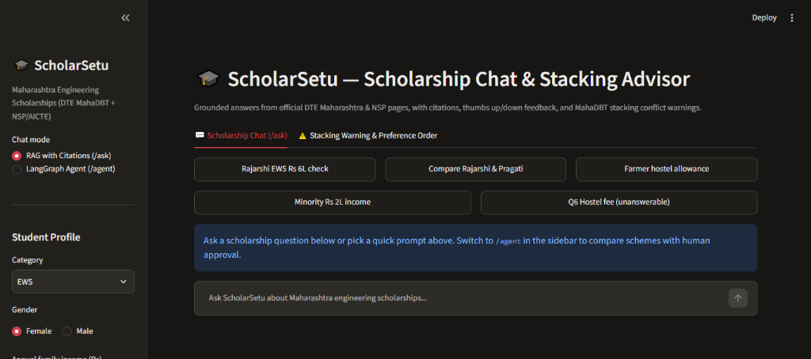

# ScholarSetu

## Project card
- **Product:** ScholarSetu, a chatbot that matches Maharashtra engineering students to the MahaDBT and NSP/AICTE scholarships they qualify for, with amounts, income limits and deadlines
- **User:** Maharashtra engineering students from reserved and economically weaker categories
- **Problem:** Students apply only for schemes they have heard of, such as EBC, and miss the one meant for their category
- **Data source:** DTE Maharashtra Scholarship Section (https://dte.maharashtra.gov.in) and National Scholarship Portal (https://scholarships.gov.in/All-Scholarships)

## Project structure
```
ScholarSetu/
├── analysis/
│   └── explore.py           # prints 3 facts about the records (pandas)
├── app/
│   ├── agent_loop.py        # hand-written agent: reason, act, observe
│   ├── chunking.py          # cuts the downloaded pages into chunks (source, page, title)
│   ├── cli.py               # menu program that uses records.py
│   ├── embed.py             # embeddings + semantic search over the chunks
│   ├── fetch.py             # downloads source pages into data/raw/
│   ├── graph.py             # the agent rebuilt in LangGraph (memory + approval)
│   ├── ingest.py            # cleans downloaded pages into data/records.json
│   ├── llm.py               # asks Groq or Gemini (keys come from .env)
│   ├── main.py              # FastAPI service
│   ├── models.py            # Record dataclass
│   ├── rag.py               # answers from retrieved chunks, with citations
│   ├── records.py           # load_records, search, count_by, get_by_id
│   ├── smart_search.py      # TF-IDF + cosine ranking, powers /search
│   ├── stacking.py          # MahaDBT/NSP stacking rules & highest-value preference order
│   ├── tools.py             # compare_schemes tool
│   └── vectorstore.py       # persistent Chroma index, powers /search/semantic
├── data/
│   ├── chroma/              # Chroma index (not pushed to GitHub)
│   ├── raw/                 # downloaded pages (not pushed to GitHub)
│   ├── feedback.json        # saved by POST /feedback (not pushed to GitHub)
│   ├── questions.json       # saved by POST /questions (not pushed to GitHub)
│   ├── records.json         # clean records created by ingest.py
│   └── sample_records.py    # 20 hand-collected schemes
├── docs/
│   ├── how_llms_work.md     # how LLMs work + 10 ScholarSetu questions
│   └── ui_screenshot.png    # Streamlit UI screenshot
├── eval/
│   ├── eval_results.md      # every answer of the two RAG configurations
│   ├── eval_set.json        # 15 evaluation questions
│   ├── prompt_compare.md    # v1 vs v2 prompt comparison
│   ├── run_eval.py          # runs the RAG evaluation
│   ├── run_prompt_compare.py
│   └── search_results.md    # top semantic-search hits for the 10 questions
├── prompts/
│   ├── system.txt           # ScholarSetu system prompt
│   ├── task_v1.txt          # task prompt, version 1
│   └── task_v2.txt          # task prompt, version 2
├── tests/
│   └── test_day10.py        # automated tests for stacking, feedback, RAG Q6 refusal, agent approval & UI
├── ui/
│   └── app.py               # Streamlit chat UI with citations, feedback & stacking warning
├── .env.example             # copy to .env and add your key (.env is private)
├── day01_intro.py
├── day01_menu.py
├── day02_search.py
├── day03_models_demo.py
├── requirements.txt
└── README.md
```

## Record fields
Each scheme is a dict with: `scheme_name`, `department`, `eligible_category`, `income_limit`, `benefit`, `source_url`, plus `id` and `verified`.
`income_limit` is `null` when the official page does not state one. `verified: true` means the record was read from the official page.

## Day 1
- `day01_intro.py` - prints the project card and asks for name and question
- `day01_menu.py` - menu loop: about, sample questions, eligibility check

## Day 2
- `data/sample_records.py` - 20 hand-collected schemes: 10 from the DTE Maharashtra Scholarship Section and 10 NSP central-sector schemes
- `day02_search.py` - prints all records, searches by keyword, counts records per department and per eligible category
- `app/records.py` - reusable functions: `load_records()`, `search()`, `count_by()`, `get_by_id()`
- `app/cli.py` - menu program that uses the functions in `records.py`

## Day 3
- `app/fetch.py` - downloads the NSP All-Scholarships page and the 10 DTE Scholarship Section pages into `data/raw/` with timeouts, retries and error handling
- `app/ingest.py` - parses each downloaded DTE scheme page into the record fields (scheme name, eligible category, income limit, benefit), skips incomplete pages with a log message, and saves `data/records.json`
- `app/models.py` - `Record` dataclass for one scheme
- `app/records.py` - `load_records()` reads `data/records.json`; `load_record_objects()` returns `Record` objects
- `day03_models_demo.py` - converts loaded dicts into `Record` objects

## Day 4
- `app/main.py` - FastAPI service with these endpoints:
  - `GET /health` - service status and number of schemes loaded
  - `GET /records?limit=` - list schemes (default 10, max 100)
  - `GET /records/{id}` - one scheme, 404 if it does not exist
  - `GET /search?q=` - schemes ranked by relevance, each with a `score`
  - `POST /questions` - saves a user question to `data/questions.json`
- `app/smart_search.py` - ranks records with TF-IDF + cosine similarity; powers `/search`
- `analysis/explore.py` - prints 3 facts about the records using pandas: data completeness, departments with the most schemes, and the collected income limits

## Day 5
- `docs/how_llms_work.md` - notes on how LLMs work, with one diagram, and 10 ScholarSetu user questions (Q6 is a question the data cannot answer)

## Day 6
- `app/llm.py` - one function, `ask_llm()`, that talks to Groq or Gemini (timeouts, retries, rate-limit handling); keys and model names come from `.env`
- `app/main.py` - new `POST /chat`: answers a student question with the ScholarSetu system prompt and returns JSON with `answer`, `confidence` (`high`, `medium` or `low`) and `follow_up`; the optional `prompt_version` (`v1` or `v2`) picks the task prompt
- `prompts/` - `system.txt` and two task prompts, `task_v1.txt` and `task_v2.txt`
- `eval/prompt_compare.md` - the two prompt versions compared on the 10 ScholarSetu questions; `eval/run_prompt_compare.py` creates it

## Day 7
- `app/chunking.py` - cuts the downloaded pages into chunks (about 120 words, 25 words overlap); the NSP list gives one chunk per scheme. Every chunk keeps its source URL, page and title (these are web pages, so the page is always 1)
- `app/embed.py` - turns text into embeddings (sentence-transformers, `all-MiniLM-L6-v2`) and runs semantic search; `python -m app.embed` searches the 10 ScholarSetu questions and writes `eval/search_results.md`
- `eval/search_results.md` - the top 3 hits for each of the 10 questions, with scores; a best score below 0.30 is marked "no confident match"
- `app/vectorstore.py` - indexes all chunks into a persistent Chroma collection (`data/chroma/`); the index is built automatically on the first search, or rebuilt with `python -m app.vectorstore`
- `app/main.py` - new `GET /search/semantic?q=` returns the closest chunks with `score`, `title`, `source`, `page` and `text`

## Day 8
- `app/rag.py` - retrieves the best chunks for a question, gives them to the model as numbered sources, and returns an answer with `[n]` citations; if the sources do not contain the answer it says "I don't know" (no citation means no answer)
- `app/main.py` - new `POST /ask` returns `answer`, `answerable`, `confidence` and `citations` (title, source, page, score)
- `app/chunking.py` and `app/vectorstore.py` - the chunk size is now an option, so two configurations can be compared
- `eval/eval_set.json` - 15 evaluation questions with expected sources and answers (12 the sources can answer, 3 they cannot, including the hostel-fee question)
- `eval/run_eval.py` - runs the 15 questions with two configurations (chunk size / top-k) and prints the table below; the details are saved in `eval/eval_results.md`

## RAG evaluation
15 questions from `eval/eval_set.json` (12 that the sources can answer, 3 that they cannot). Two configurations were run on the same questions with `python eval/run_eval.py`.

| Config | Chunk size | Top-k | Retrieval hit-rate | Answers correct | "I don't know" correct | Overall | Avg time per question |
|---|---|---|---|---|---|---|---|
| A | 120 words | 3 | 11/12 | 11/12 | 3/3 | 14/15 | 2.3 s |
| B | 60 words | 5 | 12/12 | 11/12 | 3/3 | 14/15 | 2.2 s |

**Winner: config B** (chunk size 60 words, top-k 5) with 14/15 correct answers.

## Day 9
- `app/tools.py` - the `compare_schemes` tool: takes 2 to 4 scheme names, looks them up in `data/records.json` and returns a side-by-side Markdown table (benefit, eligibility, documents, apply link). Try it: `python -m app.tools "Rajarshi" "Pragati"`. `records.json` has no documents field yet, so that row says "Not listed in our data"
- `app/agent_loop.py` - a hand-written agent (reason, act, observe). The model chooses one action as JSON: search the sources with RAG, compare schemes, or give the final answer. The code runs the tools; it stops after 5 steps. Try it: `python -m app.agent_loop "Compare Rajarshi and Pragati"`
- `app/graph.py` - the same agent rebuilt in LangGraph, with memory (a conversation is saved per `thread_id`, last 5 turns, kept while the server runs) and one approval step: before the agent runs `compare_schemes` the graph pauses until a person approves or rejects it
- `app/main.py` - new `POST /agent`: send a question (add a `thread_id` to continue a conversation). If the reply status is `awaiting_approval`, send the same `thread_id` with `approve` true or false

## Day 10
- `ui/app.py` - Streamlit chat UI for ScholarSetu:
  - Calls `POST /ask` (Quick Q&A with `[n]` citations and strict "I don't know" refusal) or `POST /agent` (Smart Agent with conversation memory and Approve/Reject buttons for `compare_schemes`).
  - Shows numbered citations with clickable official source links and agent steps.
  - Saves thumbs up/down (`👍 Helpful` / `👎 Needs work`) persistently via `POST /feedback` to `data/feedback.json`.
  - **Signature feature — Stacking Warning & Highest-Value Preference Order:** marks tuition/fee schemes that cannot be taken together (MahaDBT pays only one scheme by applicant preference, and NSP/AICTE schemes cannot be double-claimed with MahaDBT fee scholarships), highlights stackable hostel add-ons (Dr. Panjabrao Deshmukh Hostel Allowance), estimates annual rupee values based on the student's college fee, gender and city tier, and suggests the highest-value preference order.
- `app/stacking.py` - stacking conflict rules, profile filtering, chat-response scheme detection and dynamic highest-value preference ranking
- `app/main.py` - new `POST /feedback`, `GET /feedback` and `POST /stacking` endpoints
- `tests/test_day10.py` - 15 automated tests covering stacking rules, fee-sensitive preference flipping, feedback persistence, Q6 refusal, agent approval pause/resume and a Streamlit `AppTest` smoke check

### Streamlit UI Screenshot


## How to run
Run all commands from the project root folder.

    python -m venv venv
    venv\Scripts\activate
    pip install -r requirements.txt

    python day01_intro.py
    python day01_menu.py
    python day02_search.py

    python -m app.fetch
    python -m app.ingest
    python -m app.cli
    python day03_models_demo.py

    python analysis/explore.py

    python -m app.chunking
    python -m app.embed
    python -m app.vectorstore

    python eval/run_eval.py

    python -m app.tools "Rajarshi" "Pragati"
    python -m app.agent_loop "Compare Rajarshi and Pragati"

    python -m unittest discover -s tests -v

### Set up the API key (needed for /chat, /ask and /agent)
1. Get a free key from https://console.groq.com/keys (or https://aistudio.google.com/apikey for Gemini).
2. Copy `.env.example` to `.env` and put your key in it. `.env` is private and is not committed.

### Run the API
    uvicorn app.main:app --reload

Then open http://127.0.0.1:8000/docs to try every endpoint, including `POST /chat`, `GET /search/semantic`, `POST /ask`, `POST /agent`, `POST /feedback` and `POST /stacking`.

### Run the Streamlit UI
Keep the FastAPI server running in one terminal, then start Streamlit in a second terminal:

    streamlit run ui/app.py

Open http://localhost:8501 to chat with ScholarSetu, view citations, save thumbs up/down feedback, and check MahaDBT stacking warnings and preference order.

### Try the agent with approval
1. `POST /agent` with `{"question": "Compare Rajarshi and Pragati"}`. The reply has `status: awaiting_approval`, the `pending_action` and a `thread_id`.
2. `POST /agent` with `{"thread_id": "<the thread_id>", "approve": true}`. The tool runs and the reply holds the answer. With `approve: false` the tool is not run.
3. Send another question with the same `thread_id` to continue the conversation.

### Compare the two prompts
    python eval/run_prompt_compare.py

## Notes
- The DTE site sometimes returns a 503 error. `fetch.py` retries and skips files it already has; use `python -m app.fetch --force` to download everything again.
- The NSP page lists scheme names and dates only; scheme details are in guideline PDFs that NSP does not allow scripts to download, so NSP schemes are not in `records.json`. They are in the semantic search as one chunk per scheme (name, department, dates).
- `data/sample_records.py` is the Day 2 hand-collected list and is not used by `ingest.py`.
- `/chat` does not use `records.json` yet; the answers come from the model and the system prompt only. `/ask` answers only from the retrieved chunks.
- The first run of `python -m app.embed` downloads the embedding model (about 90 MB), so it needs internet.
- `data/chroma/` is not pushed to GitHub. Run `python -m app.vectorstore` to rebuild it after downloading new pages.
- The agent's memory (`/agent`) is kept in the server's memory, so it is lost when the server restarts.
- `data/feedback.json` is git-ignored; thumbs up/down entries saved from the Streamlit UI stay local.
