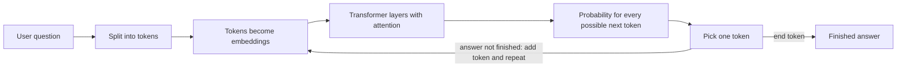

# How LLMs work (in my own words)

An LLM (large language model) is a very big neural network that is trained to guess the next small piece of text. Answers, summaries and code all come from doing that one guess again and again.

## 1. From a neuron to a network

A neuron takes some numbers, multiplies each one by a weight, adds them up and passes the result through a small function. A layer is many neurons side by side, and a network is many layers one after another.

Training means changing the weights so the network makes fewer mistakes. The "loss" is a number that says how wrong the network was. Gradient descent takes small steps in the direction that makes the loss smaller, like walking downhill, and it does this millions of times.

## 2. Words become numbers: tokens and embeddings

A computer cannot read words, so the text is cut into tokens (whole words or pieces of words). Each token is turned into a list of numbers called an embedding. Tokens with similar meaning get similar numbers, so "scholarship" and "financial aid" end up close together even though the words are different. This is why meaning-based search works better than keyword search, and I will use it for ScholarSetu later.

## 3. Transformers and attention

Most LLMs are transformers. Inside a transformer, attention lets every word look at all the other words in the text and decide which ones matter. In "The girl applied because she was eligible", attention helps the model connect "she" with "girl". A transformer repeats this over many layers, so it builds up a better understanding of the text at each step.

## 4. How an answer is produced

The model does not write the whole answer at once. It predicts one token, adds it to the text, and predicts the next one.

The temperature setting controls how adventurous the pick is. Low temperature picks the most likely token, and high temperature picks more varied ones.

## 5. How an LLM is trained

1. **Pre-training:** the model reads a huge amount of text and practises predicting the next token. This is where it learns language and a lot of facts.
2. **Instruction tuning:** it is trained on examples of questions with good answers, so it learns to follow instructions instead of just continuing text.
3. **RLHF (reinforcement learning from human feedback):** people rank different answers, and the model is nudged towards the answers people prefer.

## 6. What LLMs get wrong

- **Hallucination:** the model produces text that sounds right because it is likely, not because it checked a fact. It can invent a scheme, an amount or a date.
- **Context window:** it can only look at a limited amount of text at once.
- **Knowledge cutoff:** it knows nothing that happened after its training, and scholarship rules and deadlines change every year.
- **Cost:** you pay for the tokens you send and the tokens it writes, so long prompts cost more.

## 7. What this means for ScholarSetu

If I ask a plain LLM "Which scholarship fits an OBC girl with Rs 3.2 lakh income?", it may confidently invent a scheme or an old deadline. So ScholarSetu will first find the matching schemes in its own data (`data/records.json`), give only those to the model, and answer from them with the source link. If the data does not contain the answer, it should say "I don't know" instead of guessing. I will build this in the next weeks.

## ScholarSetu user questions

1. I am OBC with Rs 3.2 lakh income. Which scholarship fits me?
2. What is the difference between EBC and OBC Freeship?
3. Which documents do I need for MahaDBT?
4. Is there an AICTE or NSP scholarship I can apply for?
5. What is the last date to apply this year?
6. What is the hostel fee at Sanjivani College of Engineering? *(my data cannot answer this one, so ScholarSetu should say "I don't know")*
7. I am a girl studying engineering. Which schemes cover my tuition fee?
8. My family income is Rs 6 lakh and I am from an EWS family. Can I get the Rajarshi Chhatrapati Shahu Maharaj scholarship?
9. How much hostel allowance can I get if my parents are small-land farmers?
10. I belong to a minority community and my family income is Rs 2 lakh. Which scholarship can I apply for?